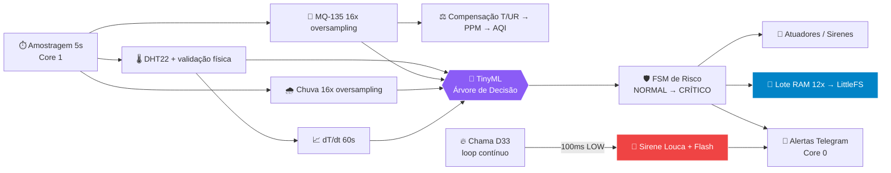

<div align="center">


```
  █████╗ ████████╗ █████╗ ██╗      █████╗ ██╗ █████╗     ██████╗ 
 ██╔══██╗╚══██╔══╝██╔══██╗██║     ██╔══██╗██║██╔══██╗    ╚════██╗
 ███████║   ██║   ███████║██║     ███████║██║███████║     █████╔╝
 ██╔══██║   ██║   ██╔══██║██║     ██╔══██║██║██╔══██║     ╚════██╗
 ██║  ██║   ██║   ██║  ██║███████╗██║  ██║██║██║  ██║    ██████╔╝
 ╚═╝  ╚═╝   ╚═╝   ╚═╝  ╚═╝╚══════╝╚═╝  ╚═╝╚═╝╚═╝  ╚═╝    ╚═════╝ 
```

### 🛰️ ESTAÇÃO AUTÔNOMA DE MONITORAMENTO AMBIENTAL, RISCOS E ALERTA CRÍTICO
**Engenharia Embarcada de Alta Precisão • Telemetria Dual-Stack • TinyML de Borda • ESP32 Baremetal C++**

<a href="https://git.io/typing-svg">
  
</a>

---

[](https://espressif.com/)
[](https://www.arduino.cc/)
[](https://github.com/)
[](https://core.telegram.org/bots/api)
[](https://en.wikipedia.org/wiki/Wi-Fi)
[](https://github.com/)

[](#-motor-tinyml-de-borda)
[](#-arquitetura-dual-core-freertos)
[](#-persistência-flash-e-integridade)
[](#-segurança-e-privacidade)
[](#-licença)


[Visão Geral](#-visão-geral) • [Arquitetura de Hardware](#-arquitetura-de-hardware) • [Topologia dos Sensores](#-topologia-dos-sensores-e-atuadores) • [TinyML](#-motor-tinyml-de-borda) • [Pilha de Rede e Modos](#-pilha-de-rede-e-modos-operacionais) • [Painel Web & Telemetria](#-painel-web-embarcado) • [Comandos Telegram](#-central-de-comando-telegram) • [Segurança](#-segurança-e-privacidade) • [Como Compilar](#-guia-de-compilação-e-deploy)

---

</div>

## ⚡ Visão Geral

O **ATALAIA 3** é uma estação embarcada industrial de monitoramento de risco e telemetria climática de tempo integral. Projetado sobre microcontrolador **ESP32**, opera sob uma arquitetura puramente assíncrona e não-bloqueante baseada em máquinas de estados finitos (FSM) por temporizadores `millis()`, eliminando travamentos de clock e garantindo reatividade de sub-milissegundos para emergências extremas.

* **Detecção Óptica de Fogo Instantânea:** Filtro integrativo em pino digital com emissão de alarme acústico histerese em alta frequência.
* **Índice de Qualidade do Ar (AQI) e Gás:** Análise e linearização da resistência de superfície ($R_s/R_0$) do sensor MQ-135, entregando PPM **compensado por temperatura e umidade** e cálculo AQI (0 a 500) em tempo real.
* **Dual-Buzzer Acoustic Management:** Disparo seletivo de pulsos atômicos ultracurtos (tick tático de 12ms estilo detonador) para rotinas de amostragem e sirenes sweep de varredura contínua (800Hz a 3200Hz) para sinistros.
* **Buffer Flash Circular Não-Volátil:** Anel FIFO em partição LittleFS registrando até 8.640 registros completos (12 horas ininterruptas a cada 5 segundos) sem degradação do ciclo de escrita do silício, via **gravação em lote (wear leveling)**.
* **Comutação Híbrida de Conectividade:** Fallback automático entre cliente de rede local (STA) e ponto de acesso emergencial autônomo (SoftAP) com servidor DNS para Captive Portal integrado.
* **Inteligência de Borda (TinyML):** Classificador nativo de 4 estados de risco ambiental, sem alocação dinâmica e com complexidade `O(profundidade)`.
* **Alerta Preditivo de Pré-Combustão:** Derivada térmica `dT/dt` em janela deslizante de 60 s antecipa focos de incêndio *antes* da chama visível.
* **Dual-Core FreeRTOS:** Core 1 dedicado à aquisição e segurança; Core 0 dedicado a Wi-Fi, servidor HTTP e Telegram — a rede nunca atrasa um alarme.
* **Diagnóstico de Saúde do SoC:** Temperatura do silício, heap, fragmentação, RSSI e causa do último reset (Brownout, WDT, Panic…).

<div align="center">

| 🔥 Fogo | 🧪 Gás / AQI | 🌡️ Temp & Umid | 🌧️ Chuva | 🧠 TinyML | 💾 Flash 12h | 🤖 Telegram |
| :---: | :---: | :---: | :---: | :---: | :---: | :---: |
| IR 760–1100nm | MQ-135 comp. | DHT22 + dT/dt | ADC 16x | 4 estados | 8.640 regs | 40+ comandos |

</div>

---

## 📐 Diagrama de Blocos do Sistema

```
                      ┌──────────────────────────────────────────────┐
                      │            ALIMENTAÇÃO REGULADA              │
                      │               5V DC / 2A                     │
                      └──────────────────────┬───────────────────────┘
                                             │
      ┌──────────────────────────────────────┼──────────────────────────────────────┐
      │                                      │                                      │
┌─────▼──────────────┐             ┌─────────▼───────────┐                ┌─────────▼──────────┐
│   SENSORES ANALÓG. │             │  MICROCONTROLADOR   │                │ ATUADORES ACÚST./  │
│      & DIGITAIS    │             │   ESP32 DUAL CORE   │                │     ÓPTICOS        │
├────────────────────┤             ├─────────────────────┤                ├────────────────────┤
│ • DHT22 (GPIO 04)  ├──GPIO 04───►│ • CPU Xtensa LX6    │────GPIO 18────►│ • Buzzer 3V (PWM)  │
│ • MQ-135 (GPIO 34) ├──GPIO 34───►│ • LittleFS Flash DB │────GPIO 27────►│ • Buzzer 5V (Dig)  │
│ • Chuva (GPIO 32)  ├──GPIO 32───►│ • HTTP WebServer    │────GPIO 19────►│ • LED Heartbeat    │
│ • Chama (GPIO 33)  ├──GPIO 33───►│ • TLS Telegram Bot  │                └────────────────────┘
└────────────────────┘             │ • TinyML Edge Model │
                                   └──────────┬──────────┘
                                              │
                     ┌────────────────────────┴────────────────────────┐
                     │                                                 │
          ┌──────────▼───────────┐                          ┌──────────▼───────────┐
          │     MODO STATION     │                          │     MODO SOFT-AP     │
          │  (Roteador / Nuvem)  │                          │  (Recuperação Local) │
          ├──────────────────────┤                          ├──────────────────────┤
          │ • Telegram API HTTPS │                          │ • SSID: atalaia3     │
          │ • Sincronismo NTP    │                          │ • WPA2 | Senha: ****** │
          │ • Geolocalização     │                          │ • IP: 192.168.***.***│
          │ • mDNS atalaia3.local│                          │ • DNS Captive Portal │
          └──────────────────────┘                          └──────────────────────┘
```

### 🧬 Fluxo Operacional (Mermaid)



---

## 🎛️ Arquitetura de Hardware

### Pinout Mapeado (ESP32 DevKit v1)

| Pino GPIO | Tipo | Barramento / Periférico | Função Atribuída | Tensão Lógica |
| :--- | :---: | :---: | :--- | :---: |
| **GPIO 04** | I/O | Digital Direto | Sensor Termo-higrométrico DHT22 | 3.3V |
| **GPIO 18** | Output | LEDC Canal 1 (PWM) | Buzzer Passivo 3.3V (Sirene, Varreduras, Melodias) | 3.3V |
| **GPIO 19** | Output | LEDC Canal 0 (PWM) | LED Verde de Status (Heartbeat / Flash Síncrono) | 3.3V |
| **GPIO 27** | Output | Digital Push-Pull | Buzzer Ativo 5V (Bip Seco Direto) | 5.0V |
| **GPIO 32** | Input | ADC1 Canal 4 | Placa Condutora de Chuva (Analógico Oversampled) | 3.3V |
| **GPIO 33** | Input | Digital Pull-Up | Sensor Óptico de Chama / Fogo (LOW = Foco Ativo) | 3.3V |
| **GPIO 34** | Input | ADC1 Canal 6 | Sensor de Gás e Fumaça MQ-135 (Analógico) | 3.3V |

> ⚠️ **Atenção:** Os GPIOs 34, 35, 36 e 39 do ESP32 são pinos exclusivos de entrada (`Input-Only`) e não possuem resistores de pull-up ou pull-down internos configuráveis via software.

> 💡 **Nota de ADC:** Resolução de 12 bits (0–4095) com atenuação de 11 dB (`ADC_11db`), cobrindo a faixa útil de ~0 a 3.3 V. Os pinos usados estão todos no **ADC1**, que permanece utilizável com o Wi-Fi ativo.

### 🔌 Parâmetros PWM (LEDC)

| Canal | Pino | Frequência | Resolução | Uso |
| :---: | :---: | :---: | :---: | :--- |
| `0` | GPIO 19 | 5 kHz | 8 bits | LED Verde — efeito *breathing* (respiração) |
| `1` | GPIO 18 | 2,7 kHz (base) | 8 bits | Buzzer 3.3V — tons dinâmicos via `ledcWriteTone` |

> O firmware é **compatível com Arduino-ESP32 v2.0.x e v3.0+**, selecionando automaticamente a API LEDC correta em tempo de compilação (`ESP_ARDUINO_VERSION_VAL`).

---

## 🧪 Topologia dos Sensores e Atuadores

### 1. Fogo & Incêndio (Pino D33)
* **Princípio:** Sensor de detecção de infravermelho de 760nm a 1100nm.
* **Imunidade a Ruídos:** Filtro integrativo temporal que exige 100ms de disparo contínuo em nível lógico baixo (`LOW`) antes de deflagrar o evento de emergência, evitando falsos positivos por radiação solar.
* **Retenção (Hold):** Após o desaparecimento do sinal, o estado de emergência é mantido por 600 ms, impedindo oscilações (*chattering*) na sirene.
* **Ação Imediata:** Desarma instantaneamente tarefas secundárias, interrompe bipes de amostragem e arma varredura histerética contínua (800Hz–3200Hz) com flash simultâneo e despacho prioritário via HTTPS no Telegram (notificação sonora ativa, cooldown de 15 s).
* **Verificação contínua:** Executada em **todo ciclo do `loop()`** (~5 ms), independente do período de amostragem de 5 s.

### 2. Gás & Fumaça MQ-135 (Pino D34)
* **Modelagem Psicrométrica:** Conversão SAR ADC 12 bits (0-4095) com 16 leituras de oversampling com espaçamento micro-controlado.
* **Cálculo da Resistência de Carga ($R_s$):**
  $$V_{out} = \left(\frac{ADC_{raw}}{4095}\right) \times 3.3V$$
  $$R_s = R_L \times \left(\frac{3.3 - V_{out}}{V_{out}}\right) \quad [R_L = 10\text{k}\Omega]$$
* **Compensação Higrotérmica (novo):** O sensor SnO₂ deriva com temperatura e umidade. O firmware aplica um fator de correção por regressão de superfície bidimensional:
  $$CF = 1{,}898 - 0{,}0242\,T - 0{,}0035\,UR + 0{,}00018\,T\,\frac{UR}{100} \qquad \left(0{,}35 \le CF \le 2{,}2\right)$$
  $$\frac{R_s}{R_0}\Big|_{corr} = \frac{R_s / R_0}{CF} \qquad PPM = 400 \times \left(\frac{R_s}{R_0}\Big|_{corr}\right)^{-1{,}85}$$
  com $R_0 = 36\,k\Omega$ de referência para ar limpo (~400 ppm) e saída limitada entre **350 e 5000 ppm**.
* **Warm-up do sensor:** Janela padrão de **5 minutos** de pré-aquecimento (`DEFAULT_WARMUP_MS`), com contagem regressiva no painel e opção de *pular* (`fast`) para bancada.
* **Histerese de Alarme:** Rearme somente quando o gás cai abaixo de `limiar − 35 ppm`, evitando *flapping*.
* **Escala do AQI (Índice de Qualidade do Ar):** Mapeamento segmentado de 0 a 500, classificando o ar em *Excelente*, *Bom*, *Moderado*, *Ruim*, *Muito Ruim* e *Perigoso*.

<details>
<summary><b>📊 Tabela completa de faixas do AQI (clique para expandir)</b></summary>

| Faixa PPM (comp.) | AQI | Categoria | Cor sugerida |
| :--- | :---: | :--- | :---: |
| 350 – 400 | 10 – 25 | 🟢 EXCELENTE (Puro) | `#10b981` |
| 400 – 600 | 26 – 50 | 🟩 BOM (Normal) | `#84cc16` |
| 600 – 1000 | 51 – 100 | 🟡 MODERADO (Atenção) | `#f59e0b` |
| 1000 – 1500 | 101 – 150 | 🟠 RUIM (Prejudicial) | `#f97316` |
| 1500 – 2500 | 151 – 200 | 🔴 MUITO RUIM (Insalubre) | `#ef4444` |
| 2500 – 5000 | 201 – 500 | 🟣 CRÍTICO / PERIGOSO | `#7f1d1d` |

</details>

### 3. Temperatura & Umidade — DHT22 (Pino D04)
* **Validação em 3 camadas:** (1) rejeição de `NaN`; (2) envelope físico (`-20…85 °C`, `0…100 %`); (3) gradiente impossível em 5 s (`ΔT > 8 °C` ou `ΔUR > 25 %` ⇒ amostra *suspeita*).
* **Qualidade do dado:** Cada registro é marcado como `VÁLIDO`, `SUSPEITO` ou `INVÁLIDO` e, em caso de falha, o último valor válido é preservado.
* **Índices derivados:**
  * **Sensação Térmica (Heat Index)** — regressão de Rothfusz (NWS) com fallback simplificado.
  * **Ponto de Orvalho** — fórmula de Magnus-Tetens (`a = 17,27`, `b = 237,7`).
  * **Taxa `dT/dt`** — janela deslizante de 12 amostras (60 s) em °C/min.

### 4. Chuva (Pino D32)
* **Leitura:** Placa condutora com 16× oversampling; chuva confirmada quando `ADC < 2400` (limiar configurável em `RAIN_THRESHOLD`).
* **Reação:** Aciona a **melodia de chuva** (Jingle Bells, não-bloqueante) e envia alerta ao Telegram com cooldown de 45 s.

### 5. Dual-Buzzer Engine (Tick Atômico vs Sirenes de Risco)
* **Bip de Amostragem (Estilo Detonador de Filme):** Para impedir que a latência da fila de rede ou do servidor HTTP atrase o corte sonoro, a função física aplica um pulso estrito de 12ms a 15ms finalizado via hardware direto, assegurando um estalo curto, percussivo e ininterrupto.
* **Sirene Louca de Incêndio:** Varredura em onda triangular agressiva a passos de 95Hz a cada 8ms entre 800Hz e 3200Hz no canal PWM D18, associada a chaveamento estroboscópico em quadratura no pino D27.
* **Alarme de Gás:** Pulsos de onda quadrada em 3,1 kHz (140 ms ON / 90 ms OFF) simultâneos nos dois buzzers.
* **Melodia de Chuva / Natal:** Partitura completa de *Jingle Bells* gravada na Flash, executada por máquina de estados não-bloqueante.
* **Prioridades:** `Fogo > Gás > Chuva`. O fogo nunca é interrompido por outro alarme.
* **Chaves de silêncio:** *Som Mestre*, *Bip de Coleta*, *Sirenes de Risco* e *Flash de Coleta* são independentes e persistidas na Flash.

### 6. LED Verde de Status (Pino D19)
| Modo | Comportamento |
| :--- | :--- |
| `AUTO` | *Breathing* suave (brilho 2→160, passo 3 a cada 25 ms) + flash de 35 ms a cada coleta |
| `ON` | Forçado aceso (255) |
| `OFF` | Forçado apagado |
| `STANDBY` | Sempre apagado |

---

## 🧠 Motor TinyML de Borda

Classificador **nativo e determinístico** implementado como árvore de decisão compilada (`AtalaiaModel.h`) — **zero alocação dinâmica**, sem bibliotecas externas, executado a cada amostragem.

**Entradas:** `temperatura`, `umidade`, `Rs/R0 corrigido`, `ADC de chuva`, `dT/dt`.

| Estado | Código | Gatilhos principais | Cor |
| :--- | :---: | :--- | :---: |
| 🟢 `AMBIENTE_ESTAVEL` | `0` | Parâmetros dentro do envelope operacional | `#10b981` |
| 🔵 `CONDENSACAO_ORVALHO_CRIT` | `1` | `UR ≥ 93 %` e `T ≤ 27 °C`, ou ponto de orvalho colado à temperatura | `#0284c7` |
| 🔴 `ANOMALIA_PRE_COMBUSTAO` | `2` | `dT/dt ≥ 2,2 °C/min` com `T ≥ 34 °C`; ou `Rs/R0 < 0,38` com `T ≥ 38 °C`; ou `T ≥ 52 °C` | `#ef4444` |
| 🟣 `CHUVA_CONVECTIVA` | `3` | `ADC < 1900`, ou `ADC < 2400` com `UR > 82 %` | `#8b5cf6` |

```
                    ┌─────────────────┐
                    │  rain_adc<1900? │──sim──► CHUVA_CONVECTIVA
                    └────────┬────────┘
                             │ não
                    ┌────────▼────────┐
                    │ dT/dt≥2.2 & T≥34│──sim──► ANOMALIA_PRE_COMBUSTAO
                    │ Rs/R0<.38&T≥38  │
                    │ T ≥ 52 °C       │
                    └────────┬────────┘
                             │ não
                    ┌────────▼────────┐
                    │ UR≥93 & T≤27    │──sim──► CONDENSACAO_ORVALHO_CRIT
                    └────────┬────────┘
                             │ não
                             ▼
                     AMBIENTE_ESTAVEL
```

### 🛡️ Máquina de Estados de Risco (FSM)

| Nível | Nome | Condição |
| :---: | :--- | :--- |
| `3` | 🔴 **CRÍTICO** | Chama confirmada no D33 |
| `2` | 🟠 **ALERTA** | `gás ≥ limiar` **ou** `dT/dt ≥ 2,2 °C/min` |
| `1` | 🟡 **ATENÇÃO** | `gás ≥ limiar − 35 ppm` **ou** chuva detectada |
| `0` | 🟢 **NORMAL** | Nenhuma das anteriores |

---

## ⚙️ Arquitetura Dual-Core FreeRTOS

```
┌───────────────────────────── ESP32 (Xtensa LX6 Dual-Core) ─────────────────────────────┐
│                                                                                        │
│  ┌──────────── CORE 1 (loop) ────────────┐   ┌──────────── CORE 0 (NetworkTask) ─────┐ │
│  │ • Sensor de chama (a cada ~5 ms)      │   │ • handleNetworkMaintenance()          │ │
│  │ • FSM de buzzers e LED                │   │ • server.handleClient()               │ │
│  │ • Amostragem + TinyML (a cada 5 s)    │   │ • Polling Telegram (2,2 s / 4 s)      │ │
│  │ • Console serial de desenvolvimento   │   │ • Relatório horário automático        │ │
│  │ • Gravação em lote na Flash           │   │ • Stack 8192 B | Prioridade 1         │ │
│  └───────────────────────────────────────┘   └───────────────────────────────────────┘ │
└────────────────────────────────────────────────────────────────────────────────────────┘
```

> **Por que isso importa:** um handshake TLS lento com o Telegram ou um cliente HTTP travado **jamais** atrasam a sirene de incêndio, pois a aquisição e a segurança vivem em núcleo próprio.

**Proteções de Heap:** operações TLS são abortadas quando `FreeHeap < 28 kB`, evitando *panics* por falta de memória.

---

## 💾 Persistência Flash e Integridade

### Anel FIFO com Wear Leveling
* **Capacidade:** 8.640 registros × 5 s = **12 horas** contínuas.
* **Escrita em lote:** Amostras acumulam em RAM (12 por lote) e são descarregadas a cada **1 minuto**, reduzindo ~12× as operações de escrita física.
* **Flush forçado** em: Standby, Reboot, Backup/Export, Deep Sleep e comando `flush` serial.

### Formato Binário `ATA3`
```
┌──────────────────── atalaia_buffer.bin ────────────────────┐
│ StorageHeader (16 B)                                       │
│   magic 0x41544133 "ATA3" | version 3 | record_size | cap. │
├────────────────────────────────────────────────────────────┤
│ SensorData[0..8639]  (registro packed, alinhado a 32 bits) │
│   float temp, hum, ppm_comp, heat_index, dew_point, dT/dt  │
│   uint32 uptime, session_id | int32 mq_raw, rain_raw       │
│   uint8 rain, flame, risk, quality, ml_state, checksum     │
└────────────────────────────────────────────────────────────┘
┌──────────────────── atalaia_meta.bin ──────────────────────┐
│ RingMeta: head_index | total_saved | CRC32 (IEEE 802.3)    │
└────────────────────────────────────────────────────────────┘
```

* **Integridade dupla:** `CRC32` nos metadados (ponteiro do anel) + `checksum XOR` por registro.
* **Auto-recuperação:** Metadados corrompidos são detectados e restaurados ao padrão sem travar o boot.
* **ID de Sessão:** Cada boot gera um `session_id` aleatório (`esp_random`), permitindo reconstruir o horário civil exato das amostras da sessão atual na exportação CSV.

### Arquivos no LittleFS
| Arquivo | Conteúdo |
| :--- | :--- |
| `/atalaia_buffer.bin` | Anel circular de telemetria |
| `/atalaia_meta.bin` | Ponteiros + CRC32 |
| `/audio_config.json` | Som, bip, sirenes, flash, LED, standby, limiar de gás |
| `/wifi_config.json` | Credenciais Wi-Fi (guardadas **somente** na Flash local) |

---

## 🌐 Pilha de Rede e Modos Operacionais

O sistema dispõe de chaveamento dinâmico sem reinicialização obrigatória de hardware:

```
             ┌────────────────────────────────────────────────────────┐
             │                  RECONEXÃO INTELIGENTE                 │
             └───────────────────────────┬────────────────────────────┘
                                         │
                   ┌─────────────────────┴─────────────────────┐
                   │                                           │
          [CREDENCIAIS PRESENTES]                     [SEM CONEXÃO / QUEDA]
                   │                                           │
                   ▼                                           ▼
       Tenta conectar Station (STA)                 Inicia SoftAP "atalaia3"
        ao roteador local por ~6s                    IP Padrão: 192.168.***.***
                   │                                           │
         ┌─────────┴─────────┐                                 │
      SUCESSO              FALHA                               │
         │                   │                                 │
         ▼                   └────────────────► ◄──────────────┘
Conectado à Internet                              Captive Portal Ativo
Sincroniza NTP / Geo-IP                           DNS intercepta porta 53
Habilita Bot Telegram                             Permite reconfigurar rede
```

### Comutação Transparente `/ap` vs `/sta`
* **`/ap`**: Coloca a interface de rede imediatamente em modo Ponto de Acesso protegido por WPA2 (`atalaia3`), desligando a associação externa para manutenção técnica de campo.
* **`/sta`**: Desliga o SoftAP e restaura os parâmetros de rádio salvos na partição LittleFS, reconectando ao roteador com emissão de log local e reativação da comunicação TLS com a API do Telegram.

### Recursos de Conectividade
| Recurso | Detalhe |
| :--- | :--- |
| 🔁 **Backoff progressivo** | Reconexão com espera crescente (5 s → até 60 s, passos de +10 s) |
| 🕒 **NTP Brasil** | `a.st1.ntp.br` + `pool.ntp.org`, fuso UTC-3 (Brasília) |
| 📍 **Geolocalização por IP** | Cidade/Estado/coordenadas obtidos automaticamente (reexecutado se falhar) |
| 🔎 **mDNS** | Acesso amigável em `http://atalaia3.local` |
| 🪤 **Captive Portal** | Redirecionamento 302 + endpoints de detecção Android, iOS e Windows (`/generate_204`, `/hotspot-detect.html`, `/ncsi.txt`, `/connecttest.txt`…) |
| 📡 **Potência de rádio** | TX a 19,5 dBm no modo AP, sem *sleep* de rádio quando ativo |
| 💤 **Economia em Standby** | Wi-Fi com *modem sleep* habilitado enquanto pausada |
| 🧯 **Anti-desgaste NVS** | `WiFi.persistent(false)` evita gravações contínuas na Flash |

---

## 💻 Painel Web Embarcado

Totalmente servido a partir da memória Flash (`PROGMEM`) com folha de estilo responsiva em dark mode, tipografia monoespaçada militar e consumo mínimo de RAM:

```
+-------------------------------------------------------------------------+
|                      ATALAIA 3 - PAINEL OPERACIONAL                     |
| Local: São Luís-MA | Relógio: 21/10/2026 08:42:15 | IP: 192.168.***.***  |
| [OPERACIONAL] [RISCO: NORMAL] [TINYML: AMBIENTE_ESTAVEL] [STA: ******]  |
| [MQ CALIBRADO] [AUDIO: ON] [BIP: 5V] [SIRENES: ARMADAS] [LED: AUTO]     |
+-------------------------------------------------------------------------+
| TEMPERATURA   | UMIDADE       | QUALIDADE AR  | CHUVA       | CHAMA     |
|   29.4 °C     |    72.1 %     |  AQI: 35/500  |    SECO     |  SEGURO   |
| Sens: 32.8 °C | Orv: 23.8 °C  |  ~410 ppm CO2 | ADC: 3980   | Pino D33  |
| dT/dt: +0.10  | Qualid: VÁLIDA|  (ADC: 1234)  |             |           |
+-------------------------------------------------------------------------+
| 📈 TELEMETRIA TEMPORAL (Canvas dinâmico: Temp / Umid / Gás — 30 pts)    |
+-------------------------------------------------------------------------+
| 🩺 SoC: Temp Silício | Heap | Fragmentação | RSSI | Causa do Boot | Uptime|
+-------------------------------------------------------------------------+
| [ACIONADORES]:                                                          |
| (Bip 5V D27) (Bip 3.3V D18) (Testar Ambos) [Limiar Gás: [ 600 ] Gravar] |
| (Som Mestre ON/OFF) (Bip Coleta ON/OFF) (Sirenes ON/OFF) (LED Modos)    |
| (🚨 Sirene Fogo) (Sirene Gás) (🎄 Natal) (🛑 PARAR SONS) (Backup Flash) |
| (📊 CSV) (💾 .BIN) (🧹 Purgar Telegram) (Zerar Buffer) (Standby) (Reboot)|
+-------------------------------------------------------------------------+
| 📡 Wi-Fi: [Procurar Redes] [Senha ******] (Guardar) (SoftAP) (Esquecer) |
| 📋 Registos operacionais de eventos (16 últimos, colorizados por sev.)  |
+-------------------------------------------------------------------------+
```

### ✨ Recursos do Dashboard
* 🛡️ **Modo Tático de Segurança:** Botão que mascara em tempo real **IP** (`192.168.***.***`) e **MAC** (`AA:BB:CC:XX:XX:XX`) — ideal para capturas de tela e demonstrações.
* 📈 **Gráfico Canvas ao vivo** com 30 pontos deslizantes (Temperatura, Umidade e Gás) sem bibliotecas externas.
* 🏷️ **Badges dinâmicos** de energia, risco, TinyML, rede, aquecimento do MQ, áudio, bip, sirenes e LED.
* 🩺 **Painel de Diagnóstico do SoC** atualizado a cada 3 s.
* 📶 **Assistente Wi-Fi** com varredura de redes, status de autenticação em tempo real e exibição do novo IP.
* 📋 **Log de eventos** com cores por severidade (INFO / WARN / CRÍTICO).
* ⏱️ **Atualização automática** a cada 2 s (dados), 3 s (saúde) e 5 s (logs).

### Endpoints da API REST Embarcada

| Método | Endpoint | Ação Executada | Payload / Resposta |
| :---: | :--- | :--- | :--- |
| `GET` | `/` | Dashboard SPA completo (PROGMEM) | `text/html` |
| `GET` | `/api/current` | Retorna telemetria total e estados operacionais | `JSON` estruturado |
| `GET` | `/api/health` | Saúde do SoC: heap, fragmentação, temp. silício, RSSI, reset | `JSON` |
| `GET` | `/api/logs` | Últimos 16 eventos registrados na memória volátil | `JSON` array |
| `GET` | `/api/export.csv` | Exporta todo o histórico em CSV (`;` separador, horário civil) | `text/csv` (stream) |
| `GET` | `/atalaia_buffer.bin` | Download direto do arquivo binário do LittleFS | `application/octet-stream` |
| `GET` | `/api/scan` | Varredura de redes Wi-Fi vizinhas | `{"networks":[…]}` |
| `GET` | `/api/wifi_status` | Estado da conexão Station e novo IP | `{"connected":bool,"ip":"…"}` |
| `POST` | `/api/wifi_save` | Salva credenciais e reconecta (`ssid`, `pass`) | `JSON` |
| `POST` | `/api/wifi_reset` | Esquece a rede configurada | `JSON` |
| `POST` | `/api/network/force_ap` | Comuta forçadamente para Ponto de Acesso Local | `{"action": "ap_activated"}` |
| `POST` | `/api/network/force_sta` | Restaura a conexão Station ao roteador | `{"action": "sta_activated"}` |
| `POST` | `/api/power/standby` | Alterna/define Standby (`?enable=1\|0`) | `{"standby_mode": bool}` |
| `POST` | `/api/power/reboot` | Grava metadados na Flash e reinicia a CPU | `{"action": "rebooting"}` |
| `POST` | `/api/power/sleep` | Deep Sleep seguro com Flash desmontada | `{"action": "sleeping"}` |
| `POST` | `/api/settings/sound_master_toggle` | Comuta chave mestre de áudio | `{"sound_master": bool}` |
| `POST` | `/api/settings/collection_beep_toggle` | Liga/desliga bip de coleta | `{"collection_beep": bool}` |
| `POST` | `/api/settings/collection_flash_toggle` | Liga/desliga flash do LED na coleta | `{"collection_flash": bool}` |
| `POST` | `/api/settings/risk_sirens_toggle` | Arma/desarma as sirenes de risco | `{"risk_sirens": bool}` |
| `POST` | `/api/settings/beep_device` | Seleciona atuador do bip (`?dev=0`=5V, `1`=3V, `2`=Todos) | `{"beep_device": int}` |
| `POST` | `/api/settings/gas_threshold` | Altera limiar de alarme de gás (`?val=`, 50 a 5000 ppm) | `{"gas_threshold": float}` |
| `POST` | `/api/settings/led_mode` | Modo do LED (`?mode=auto\|on\|off`) | `{"led_mode": int}` |
| `POST` | `/api/settings/warmup` | Pula ou restaura o warm-up do MQ-135 (`?mode=fast`) | `{"warmup_ms": int}` |
| `POST` | `/api/telegram/purge` | Purga a fila pendente do bot | `JSON` |
| `GET/POST` | `/test?target=…` | Testes de bancada: `buzzer5v`, `buzzer3v`, `all`, `buzzer3v_fire`, `gas_alarm`, `buzzer3v_rain`, `stop_sound`, `reset_buffer` | `JSON` |

---

## 🤖 Central de Comando Telegram

O firmware executa um cliente seguro TLS sem dependência de webhooks, processando comandos administrativos via polling curto com offset seguro. **Apenas o chat autorizado** (`AUTHORIZED_CHAT_ID`) é atendido — qualquer outro remetente é ignorado silenciosamente.

### Tabela de Comandos Homologados

| Categoria | Comando | Finalidade e Comportamento |
| :--- | :--- | :--- |
| **Telemetria** | `/report` ou `/status` | Envia relatório completo com médias (15m/1h), AQI, sensação térmica, TinyML e estado de memória. |
| | `/trend` ou `/grafico` | Mini-gráficos *sparkline* Unicode (`▁▂▃▄▅▆▇█`) de temperatura, umidade e gás. |
| | `/health` ou `/saude` | Diagnóstico do SoC: temp. silício, heap, fragmentação, RSSI, causa do reset. |
| | `/stats` ou `/medias` | Estatísticas consolidadas (1 hora e janela completa de 12 h) com mín/máx/média. |
| | `/network` ou `/ip` | Diagnóstico de rede seguro mascarando IP e MAC para capturas de tela e prints. |
| | `/network_total` ou `/ip_total` | Exibe endereços IP, Gateway, RSSI e MAC reais sem qualquer filtro. |
| | `/logs` ou `/events` | Retorna o registro dos últimos 12 eventos operacionais catalogados. |
| **Banco Flash** | `/export` ou `/csv` | Gera e envia o histórico em **CSV** direto por streaming (sem arquivo temporário). |
| | `/backup` ou `/db` | Transmite via upload HTTPS o dump do arquivo binário `atalaia_buffer.bin`. |
| | `/reset_db` | Zera ponteiros e elimina a base histórica de 12 horas. |
| | `/purge` | Executa expurgo forçado de requisições pendentes na fila da API do Telegram. |
| **Áudio e Alarme** | `/sound_on` / `/sound_off` | Habilita ou muta globalmente qualquer saída acústica da estação. |
| | `/beep_on` / `/beep_off` | Liga/desliga o bip de coleta. |
| | `/beep_dev_5v` / `_3v` / `_all` | Seleciona qual transdutor emite os ticks de amostragem. |
| | `/siren_on` / `/siren_off` | Arma ou desarma as sirenes de risco automáticas. |
| | `/gas <valor>` | Define em tempo de execução o limiar de alarme de gás em PPM (50–5000). |
| | `/test_siren` | Dispara teste da sirene estridente de incêndio com timeout de 3.5 segundos. |
| | `/test_gas` | Dispara teste do alarme sonoro de gás (3.5 s). |
| | `/natal` | Executa a partitura completa de Jingle Bells no buzzer 3.3V. |
| | `/test_3v` / `/test_5v` / `/test_all` | Bips curtos de bancada por atuador. |
| | `/stop_sound` | Silencia instantaneamente qualquer som ou sirene ativa. |
| **LED** | `/led auto` / `on` / `off` | Define o modo do LED verde. |
| | `/flash on` / `off` | Liga/desliga o flash do LED durante a coleta. |
| **Energia e Rede** | `/off` / `/on` | Comuta a estação entre Standby e Modo Operacional Integral. |
| | `/ap` | Migra rádio para ponto de acesso local `atalaia3`. |
| | `/sta` | Retoma conexão ao roteador Wi-Fi principal. |
| | `/reboot` | Salva metadados e aciona reinicialização via software do ESP32. |
| **Ajuda** | `/help` ou `/start` | Exibe a central de comandos completa. |

### 🔔 Notificações Automáticas (push)

| Evento | Gatilho | Cooldown | Notificação sonora |
| :--- | :--- | :---: | :---: |
| 🚨 **Incêndio / Chama** | Confirmação 100 ms no D33 | 15 s | ✅ Sim |
| ⚠️ **Gradiente Térmico (Preditivo)** | `dT/dt ≥ 2,2 °C/min` | 30 s | ✅ Sim |
| ⚠️ **Gás Elevado** | PPM compensado `> limiar` | 45 s | ✅ Sim |
| 🌧️ **Chuva** | `ADC < 2400` | 45 s | ✅ Sim |
| 🕐 **Relatório Horário** | A cada 60 min (fora do Standby) | — | 🔕 Silencioso |
| 🌙 / ☀️ **Standby / Operacional** | Mudança de modo | — | 🔕 Silencioso |

---

## 📤 Exportação de Dados (CSV)

Gerado em *streaming* diretamente do anel Flash (sem consumir RAM), com separador `;` compatível com **Excel em pt-BR**:

```text
Data_Hora;Timestamp_Sec;Temperatura_C;Umidade_Pct;Gas_PPM_Comp;IQA;Sensacao_C;Orvalho_C;dT_dt_C_min;MQ_ADC;Chuva_ADC;Chuva_Det;Fogo_Det;Risco;TinyML_Estado;Qualidade
21/10/2026 08:41:10;1832;29.4;72.1;410.0;26;32.8;23.8;0.10;1234;3980;0;0;NORMAL;AMBIENTE_ESTAVEL;0
```

* Registros da **sessão atual** recebem data/hora civil reconstruída via NTP; sessões antigas aparecem como `Uptime HH:MM:SS`.
* Ideal para análise em **Python (pandas)**, R, Excel ou Power BI.

<details>
<summary><b>🐍 Exemplo de análise rápida em Python</b></summary>

```python
import pandas as pd

df = pd.read_csv("atalaia_telemetria.csv", sep=";", decimal=".")
df["Data_Hora"] = pd.to_datetime(df["Data_Hora"], format="%d/%m/%Y %H:%M:%S", errors="coerce")

print(df[["Temperatura_C", "Umidade_Pct", "Gas_PPM_Comp", "IQA"]].describe())
print(df.groupby("TinyML_Estado").size())
```

</details>

---

## 🔌 Console Serial de Desenvolvimento

Baud **115200**. Comandos disponíveis no Monitor Serial:

| Comando | Ação |
| :--- | :--- |
| `status` / `report` | Estado operacional completo no terminal |
| `on` / `off` | Operacional / Standby |
| `beep` / `beep5v` / `beep3v` / `beepall` | Bips de bancada |
| `siren` / `gas` / `rain` (`natal`) | Testes de sirene de fogo, gás e melodia |
| `stop` | Silencia tudo |
| `ap` / `sta` | Alterna modo de rede |
| `flush` | Descarrega o lote RAM na Flash |
| `reboot` | Salva tudo e reinicia |

---

## 🩺 Diagnóstico e Resiliência

* **Causa do último reset** decodificada (Power-on, Brownout, Panic, WDT de tarefa/interrupção, Deep Sleep…).
* **Telemetria do SoC:** temperatura do silício, frequência dos núcleos, heap livre/mínimo histórico/maior bloco contíguo e **taxa de fragmentação**.
* **Qualidade do enlace Wi-Fi:** RSSI mapeado linearmente (`-100 dBm → 0 %`, `-50 dBm → 100 %`).
* **Log circular de 30 eventos** com severidade (INFO / WARN / CRÍTICO) e carimbo de hora NTP.
* **Deep Sleep seguro:** descarrega lote, salva metadados, desmonta o LittleFS e desliga o rádio antes de dormir.

---

## 🔒 Segurança e Privacidade

> 🛡️ Esta seção documenta as proteções do projeto. **Nenhuma credencial real é publicada neste repositório.**

| Item | Proteção aplicada |
| :--- | :--- |
| 🔑 **Token do Bot** | Exibido sempre como `SEU_TOKEN_TELEGRAM_AQUI` / `********` |
| 🆔 **Chat ID** | Autorização por chat único; valor real **nunca** versionado (`SEU_CHAT_ID_NUMERICO`) |
| 📶 **Senha do SoftAP** | WPA2, documentada como `******` — **altere o padrão antes de implantar** |
| 🌐 **IP** | Mascarado como `192.168.***.***` no painel (Modo Tático) e no Telegram (`/ip`) |
| 🔌 **MAC** | Mascarado como `AA:BB:CC:XX:XX:XX` (`/ip`); completo só via `/ip_total` |
| 👤 **Autorização** | `validateSenderAuthorization()` descarta comandos de qualquer outro chat |
| 🧯 **Heap Guard** | Handshakes TLS abortados com heap crítico (`< 28 kB`) |

### ✅ Boas práticas recomendadas
1. **Nunca** faça commit de tokens. Use um arquivo `secrets.h` listado no `.gitignore`:
   ```cpp
   // secrets.h  (NÃO versionar)
   #pragma once
   #define SECRET_BOT_TOKEN   "********"
   #define SECRET_CHAT_ID     0000000000
   #define SECRET_AP_PASSWORD "********"
   ```
2. Se algum token já foi publicado, **revogue-o imediatamente** no [@BotFather](https://t.me/BotFather) (`/revoke`) e gere outro.
3. Troque a senha padrão do SoftAP e use uma senha forte (≥ 12 caracteres).
4. O cliente TLS atual usa `setInsecure()`; para ambientes críticos, fixe o certificado raiz da API do Telegram (`setCACert`).

---

## 🗄️ Estrutura de Arquivos do Projeto

```text
atalaia3/
├── 💾 Actuators.cpp        # Motores PWM (LEDC), temporização do tick atômico, sirenes e melodias
├── 💾 Actuators.h          # Definições das rotinas acústicas e controle de iluminação
├── 💾 atalaia3.ino         # Setup de hardware, loop principal, tarefa Core 0 e console serial
├── 💾 AtalaiaModel.h       # Classificador TinyML de borda (árvore de decisão zero-allocation)
├── 💾 Config.h             # Pinagem física, estruturas de dados de telemetria e constantes
├── 💾 Diagnostics.cpp      # Saúde do SoC: heap, fragmentação, temp. silício, causa de reset
├── 💾 Diagnostics.h        # Estrutura SystemHealth e protótipos de diagnóstico
├── 💾 NetworkManager.cpp   # Pilha Wi-Fi Station, SoftAP, Captive Portal, mDNS e DNS
├── 💾 NetworkManager.h     # Declaração dos métodos de conectividade
├── 💾 Sensors.cpp          # Drivers de leitura, compensação MQ-135, AQI, dT/dt e FSM de risco
├── 💾 Sensors.h            # Protótipos das equações ambientais e de amostragem
├── 💾 Storage.cpp          # Persistência Flash circular, CRC32, CSV, NTP, Geo-IP, energia
├── 💾 Storage.h            # Assinatura dos métodos do sistema de arquivos
├── 💾 TelegramAdmin.cpp    # Procedimentos de expurgo de fila e autorização de remetente
├── 💾 TelegramAdmin.h      # Interfaces de administração remota do bot
├── 💾 TelegramBot.cpp      # Parser de comandos, uploads de arquivo/CSV e relatórios
├── 💾 TelegramBot.h        # Declarações do cliente de mensagens e telemetria remota
├── 💾 UnicodeGraphics.h    # Sparklines, barras de progresso e molduras Unicode
├── 💾 WebInterface.cpp     # Servidor HTTP, dashboard SPA (PROGMEM) e API REST
└── 💾 WebInterface.h       # Protótipo da interface Web
```

---

## 🚀 Guia de Compilação e Deploy

### 1. Requisitos de Ambiente
* **IDE:** VS Code + extensão Arduino **OU** Arduino IDE 2.x
* **Plataforma:** `esp32` by Espressif Systems (v2.0.x ou v3.0+) — compatibilidade dupla automática
* **Esquema de Partição:** `Default 4MB with spiffs (1.2MB APP / 1.5MB SPIFFS/LittleFS)`
* **Velocidade Serial:** `115200`

### 2. Bibliotecas Necessárias
Instale pelo Library Manager:
* `DHT sensor library` (Adafruit)
* `Adafruit Unified Sensor` (Adafruit)
* Bibliotecas nativas do Core ESP32: `WiFi`, `WebServer`, `DNSServer`, `LittleFS`, `WiFiClientSecure`, `ESPmDNS`, `esp_wifi`, `FreeRTOS`.

### 3. Configuração de Credenciais
Edite as diretivas em `atalaia3.ino` antes de compilar (**nunca** publique os valores reais):
```cpp
// Defina suas credenciais mestras do Bot
const char* TELEGRAM_BOT_TOKEN   = "SEU_TELEGRAM_BOT_TOKEN_AQUI";
const int64_t AUTHORIZED_CHAT_ID = SEU_CHAT_ID_NUMERICO;
```
E no `NetworkManager.cpp`, defina uma senha própria para o SoftAP:
```cpp
const char* AP_PASS = "sua_senha_aqui";   // ******** (mín. 8 caracteres)
```

### 4. Como obter Token e Chat ID
1. No Telegram, converse com o [@BotFather](https://t.me/BotFather) → `/newbot` → copie o **token**.
2. Envie qualquer mensagem ao seu bot e consulte `https://api.telegram.org/bot<TOKEN>/getUpdates` para ler o seu `chat.id`.

### 5. Primeiro Boot
1. Grave o firmware e abra o Monitor Serial (115200).
2. Sem credenciais salvas, a estação sobe o SoftAP **`atalaia3`**.
3. Conecte-se, acesse `http://192.168.***.***` (o Captive Portal abre sozinho), escolha sua rede e salve.
4. Aguarde o **warm-up de 5 min** do MQ-135 para leituras de gás confiáveis.
5. Envie `/help` ao seu bot. 🎉

---

## 🧭 Roadmap

- [x] Dual-core FreeRTOS com isolamento de rede
- [x] TinyML nativo de 4 estados
- [x] Compensação higrotérmica do MQ-135
- [x] Exportação CSV por streaming
- [x] Diagnóstico de saúde do SoC
- [ ] OTA (atualização de firmware via Wi-Fi)
- [ ] Autenticação HTTP no dashboard
- [ ] Fixação de certificado TLS (`setCACert`)
- [ ] Integração MQTT / Home Assistant
- [ ] Calibração automática de R0

---

## 🛠️ Stack Tecnológica

<div align="center">


</div>

---

## 📄 Licença

Distribuído sob a licença **MIT**. Consulte o arquivo `LICENSE` para mais informações.

---

<div align="center">


**ATALAIA 3 — ENGENHARIA DE MONITORAMENTO ROBUSTA, PRECISA E NÃO-BLOQUEANTE**

Desenvolvido para resiliência operacional contínua.


</div>
